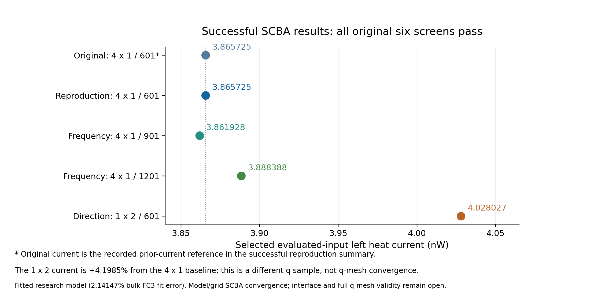

# Converged fitted-energy SCBA results

This small presentation bundle contains recorded scalar results from five
successful jobs. Every included job finished with exit status 0, reported a
fixed point, and passed the original three unmixed Sigma and three current
screens. The figures and tables can be used directly in slides.

The calculations use the same saved fitted complete-center-energy research
model, with a reported **2.14147% bulk FC3 Frobenius fit error**. These are
numerically converged results for that model and the listed grids. Physical
interface accuracy and full two-dimensional q-mesh convergence remain open.

## Results to present

| Calculation | Transverse q grid | Frequency nodes | Fresh maps in this job | Final native state | Left heat current (nW) |
| --- | --- | ---: | ---: | ---: | ---: |
| Original continuation, 25994421 | 4×1 | 601 | 11, from state 2 | 13 | 3.865724716 |
| Fresh-zero reproduction, 26010982 | 4×1 | 601 | 13 | 13 | 3.865724716 |
| Frequency study, 26010987 | 4×1 | 901 | 10 | 10 | 3.861928383 |
| Frequency continuation, 26030319 | 4×1 | 1201 | 3, from state 17 | 20 | 3.888387717 |
| Second-direction sample, 26033250 | 1×2 | 601 | 16 | 16 | 4.028026681 |

The original and fresh-zero reproduction have exactly the same recorded
current. At fixed 4×1 q sampling, the 1201-node current is **0.5863%** above
601 and **0.6851%** above 901. The 1×2 current is **4.1985%** above the 4×1/601
reference. The 1×2 grid samples another direction and is not a refinement of
4×1. The 2% comparison target is diagnostic; it does not replace the six
SCBA convergence screens.

## Figures and editable data

| Slide use | Preview | Vector figure |
| --- | --- | --- |
| Successful currents and reproducibility | [PNG](figures/successful-currents.png) | [SVG](figures/successful-currents.svg) |
| Frequency sensitivity at fixed q sampling | [PNG](figures/frequency-sensitivity.png) | [SVG](figures/frequency-sensitivity.svg) |
| Original successful convergence trajectory | [PNG](figures/original-convergence-trace.png) | [SVG](figures/original-convergence-trace.svg) |



The [current table](data/converged-currents.csv) includes job IDs, the six
original screen ratios, final-state roles and current provenance. The
[convergence trace](data/original-continuation-trace.csv) contains the 11
recorded fresh maps, native states 3–13, from the original successful
continuation. Its pass line is screen error divided by original allowance
equal to 1. Intermediate unconverged states in that successful trajectory
are retained so the numerical convergence can be shown accurately.

The [JSON bundle](data/converged-results.json) retains full scalar precision,
settings, job IDs and workspace-relative source-summary references. The
original job's compact completion summary omits currents; its current here
comes from the successful reproduction's explicitly recorded prior-current
reference. That provenance is identified in both JSON and CSV.

## Model and numerical settings

- Same preserved 728 fitted coefficients, restored without refitting.
- Coupling g = 0.03; lead eta = 0.0015625; device eta = 0.
- Temperatures 305/295 K; nine-layer, 216-DOF harmonic/Green device.
- Complete center energies in layers 2–6, with 132 active vertex coordinates.
- Common signed frequency range −7.5 to +7.5 in solver units.
- Original Sigma tolerances: relative 1e−4, absolute 1e−10.
- Original current tolerances: relative 1e−3, absolute 1e−14 W.
- Physical guards and thresholds were unchanged.

See the [solver/model guide](../../complete_energy_scba.md) for the distinction
between a cubic IFC model, optional fitting, complete endpoint derivatives,
evaluated input and unevaluated mapped fields.

## Regenerate the figures

From this directory, run:

```bash
python generate_figures.py
```

The script requires NumPy and Matplotlib and reads only the bundled scalar
JSON/CSV. It performs no transport calculation, array replay, SSH or numerical
SCBA validation. Raw IFCs, fitted parameter arrays, Green/self-energy fields,
checkpoints, environments, temporary files and failed-job outputs are not
included in this bundle. Full run evidence remains in the local reports and
preserved remote run directories.
